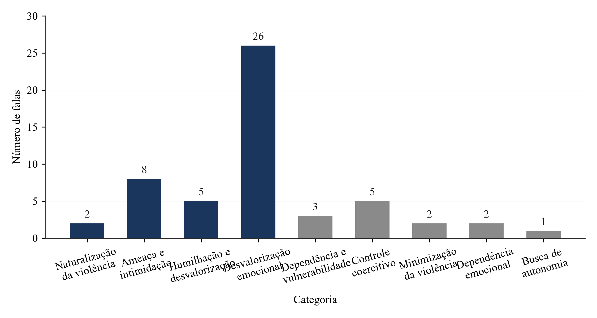
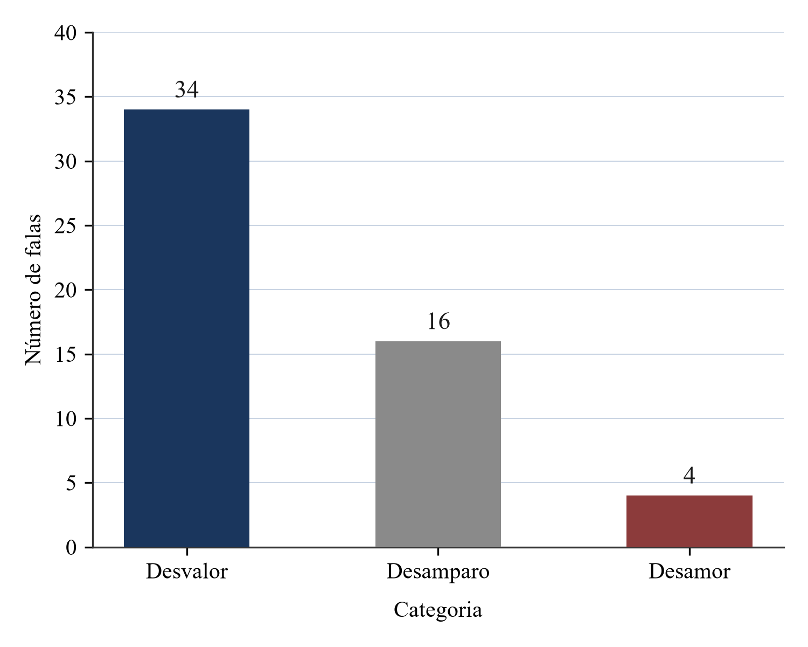

# O SILÊNCIO DAS ROSAS: UMA ANÁLISE DA VIOLÊNCIA PSICOLÓGICA CONTRA A MULHER NA PERSPECTIVA DA TERAPIA COGNITIVO-COMPORTAMENTAL

Jennifer Karoline de Mello

## RESUMO

Este estudo analisou as características de crenças centrais e comportamentos recorrentes apresentados por mulheres que sofreram violência psicológica, com base nos relatos presentes no documentário "O Silêncio das Rosas" (2022). A pesquisa qualitativa, de caráter documental, empregou a análise de conteúdo proposta por Bardin (2016) para examinar 54 falas extraídas do documentário, organizando-as em categorias temáticas. A interpretação dos dados foi realizada à luz da Terapia Cognitivo-Comportamental (TCC), fundamentada nos conceitos de crenças centrais de Judith Beck (2022). Os resultados revelaram três categorias centrais de crenças: desvalor, desamparo e desamor. Os relatos evidenciaram padrões comportamentais caracterizados por naturalização da violência, ameaça e intimidação, humilhação, controle coercitivo e dependência emocional. Conclui-se que a violência psicológica contribui para a construção e manutenção de crenças negativas, influenciando a percepção das vítimas sobre sua capacidade de rompimento com o ciclo abusivo.

**Palavras-chave:** Violência Psicológica. Violência Doméstica. Terapia Cognitivo-Comportamental. Crenças Centrais. O Silêncio das Rosas.

## ABSTRACT

This study analyzed the characteristics of core beliefs and common behaviors presented by women who suffered psychological violence, based on accounts in the documentary "O Silêncio das Rosas" (2022). The qualitative research, of documentary nature, used the content analysis proposed by Bardin (2016) to examine 54 statements extracted from the documentary, organizing them into thematic categories. Data interpretation was carried out based on Cognitive-Behavioral Therapy (CBT), grounded in Judith Beck's concepts of core beliefs (2022). Results revealed three central categories of beliefs: devaluation, helplessness, and lack of love. The accounts showed behavioral patterns characterized by normalization of violence, threat and intimidation, humiliation, coercive control, and emotional dependency. It is concluded that psychological violence contributes to the construction and maintenance of negative beliefs, influencing victims' perception of their capacity to break the abusive cycle.

**Keywords:** Psychological Violence. Domestic Violence. Cognitive-Behavioral Therapy. Core Beliefs. O Silêncio das Rosas.

## 1. INTRODUÇÃO

A violência doméstica contra a mulher permanece como um dos problemas sociais mais preocupantes da sociedade brasileira, atingindo mulheres de diferentes idades, classes sociais, raças e níveis de escolaridade. Dados do Fórum Brasileiro de Segurança Pública (2024) mostram que, no Brasil, uma mulher é assassinada a cada quatro horas, sendo grande parte desses casos relacionada à violência doméstica e familiar. Esse cenário evidencia que a violência de gênero ainda está profundamente ligada às estruturas patriarcais e às desigualdades presentes na sociedade, além de revelar dificuldades institucionais na proteção das vítimas e no rompimento do ciclo de violência. Nesse contexto, a violência doméstica pode ser compreendida como um conjunto de ações ou omissões praticadas contra a mulher em razão do gênero, causando sofrimento físico, sexual, psicológico, patrimonial ou moral, podendo inclusive resultar em morte (Brasil, 2006). Essas violências ocorrem em contextos familiares, domésticos ou em relações íntimas de afeto, não se restringindo a um grupo social específico.

Entre as manifestações mais graves está o feminicídio, caracterizado pelo assassinato de mulheres motivado por questões de gênero. Diferente de outros homicídios, o feminicídio expressa relações de desigualdade, dominação e discriminação estrutural, evidenciando a vulnerabilidade feminina em contextos marcados pelo controle e pela violência. No Brasil, a Lei nº 13.104/2015 reconhece o feminicídio como circunstância qualificadora do homicídio quando cometido por razões da condição de sexo feminino, reforçando a gravidade e a especificidade desse tipo de crime (Brasil, 2015).

O documentário "O Silêncio das Rosas" (2022), dirigido por Eliton Oliveira, reúne relatos de mulheres que sobreviveram à violência doméstica e a tentativas de feminicídio no estado do Paraná, além de abordar casos de feminicídio que ganharam repercussão nacional, como os das vítimas Tatiane Spitzner e Renata Muggiati, evidenciando a gravidade e a dimensão social desse fenômeno. Mais do que números ou estatísticas, a obra evidencia como a violência de gênero continua enraizada em estruturas patriarcais e nas desigualdades que marcam a sociedade brasileira, ao mesmo tempo em que expõe falhas institucionais que dificultam a proteção das vítimas e o rompimento com o ciclo abusivo.

Embora o documentário apresente diferentes formas de violência contra a mulher, o presente estudo delimita-se à análise da violência psicológica presente nos relatos das participantes, considerando os impactos emocionais, cognitivos e comportamentais associados a esse tipo de violência. A escolha desse recorte ocorreu devido à complexidade e, muitas vezes, à invisibilidade das agressões psicológicas. A violência psicológica, embora menos visível do que outras formas de agressão, caracteriza-se por comportamentos de humilhação, manipulação, intimidação, ameaças, isolamento social, culpabilização e controle excessivo. Ela provoca impactos significativos na estrutura cognitiva e emocional da vítima, dificultando o reconhecimento da violência, fortalecendo sentimentos de medo, insegurança e dependência emocional, e afetando diretamente a forma como a mulher percebe a si mesma, seus relacionamentos e sua capacidade de enfrentamento e ruptura da situação abusiva (Gomes, 2012; Walker, 1979; Zancan et al., 2013).

Para compreender esses impactos, o presente trabalho fundamenta-se na Terapia Cognitivo-Comportamental (TCC). Desenvolvida por Aaron Beck e aprofundada por Judith Beck, a TCC é uma abordagem psicoterapêutica que compreende que as emoções e os comportamentos dos indivíduos são influenciados pela forma como eles interpretam suas experiências e os eventos ao seu redor (Beck, 1997; Beck, 2022). Dentro dessa perspectiva teórica, um conceito fundamental é o de crenças centrais. Para a TCC, as crenças centrais correspondem a ideias mais profundas, rígidas e generalizadas desenvolvidas pelos indivíduos sobre si mesmos, sobre os outros e sobre o mundo, influenciando diretamente seus pensamentos automáticos, emoções e comportamentos (Beck, 2022).

No contexto de mulheres em situação de violência doméstica, experiências repetidas de abuso, desvalorização e controle podem contribuir para a construção e o fortalecimento de crenças centrais disfuncionais. Essas crenças podem se manifestar em pensamentos relacionados à incapacidade, desvalor, culpa, medo e desamparo, influenciando diretamente a permanência da mulher em relações abusivas e dificultando os processos de enfrentamento. Dessa forma, a análise da violência psicológica sob a perspectiva da TCC possibilita compreender como as experiências de abuso impactam a estrutura cognitiva das vítimas. Assim, este estudo busca responder ao seguinte problema de pesquisa: de que maneira a violência psicológica vivenciada por mulheres no documentário "O Silêncio das Rosas" relaciona-se com a formação de crenças centrais disfuncionais na perspectiva da Terapia Cognitivo-Comportamental? Dessa forma, o objetivo geral desta pesquisa consiste em analisar as características de crenças centrais e comportamentos em comum apresentadas por mulheres que sofreram violência psicológica no documentário "O Silêncio das Rosas", identificando padrões de comportamento presentes em seus relatos. Como objetivos específicos, busca-se identificar os pensamentos e comportamentos recorrentes apresentados pelas mulheres ao longo das situações de violência relatadas; analisar como esses comportamentos se manifestam na permanência ou dificuldade de rompimento com o ciclo de violência; relacionar os comportamentos identificados com possíveis impactos psicológicos; e categorizar as falas segundo as crenças centrais de desvalor, desamparo e desamor.

## 2. FUNDAMENTAÇÃO TEÓRICA

### 2.1 Violência Doméstica Contra a Mulher no Brasil

A violência doméstica pode ser compreendida como um conjunto de ações ou omissões dirigidas contra a mulher em razão de seu gênero, que resultam em sofrimento físico, sexual, psicológico, patrimonial ou moral, podendo chegar até a morte (Brasil, 2006). A Lei Maria da Penha (Lei nº 11.340/2006) representa um marco na legislação brasileira ao criar mecanismos para coibir e prevenir a violência doméstica e familiar contra a mulher, reconhecendo a especificidade e a gravidade desse fenômeno social. Os dados do Ministério dos Direitos Humanos e da Mulher (2023) revelam que o Brasil registrou mais de 1,5 milhão de ocorrências de violência doméstica contra a mulher nos últimos cinco anos, sendo que a grande maioria dos casos envolve algum tipo de violência psicológica, seja isoladamente ou em conjunto com outras formas de agressão.

A violência psicológica manifesta-se por meio de humilhação, controle, ameaças, intimidação e manipulação emocional, constituindo formas sutis, porém não menos danosas, de agressão. O assassinato de mulheres por razões de gênero, tipificado pela Lei nº 13.104/2015, representa a forma mais grave de violência contra a mulher. Diferente de outros homicídios, ele reflete relações de desigualdade e discriminação estrutural, evidenciando a vulnerabilidade feminina em contextos de dominação e controle social. No Brasil, as taxas de feminicídio colocam o país entre os dez mais violentos do mundo para mulheres (FBSP, 2024).

### 2.2 Violência Psicológica e Seus Impactos

A violência psicológica compreende todas as formas de agressão que não envolvem contato físico direto, incluindo comportamentos como humilhação, ameaças, isolamento social, controle de comportamentos e decisões, desvalorização da autoestima e manipulação emocional. Segundo Walker (1979), a violência psicológica constitui frequentemente o primeiro estágio do ciclo de violência, precedendo e acompanhando as agressões físicas. Os impactos da violência psicológica sobre a saúde mental das vítimas são amplamente documentados na literatura. Gomes (2012) demonstra que mulheres vítimas de violência doméstica apresentam maior prevalência de transtorno de estresse pós-traumático (TEPT), depressão, ansiedade e alterações de comportamento.

No contexto brasileiro, Zancan, Wassermann e Lima (2013) apontam que a violência doméstica, a partir do discurso de mulheres agravadas, revela padrões recorrentes de sofrimento emocional, nos quais a agressão psicológica ocupa lugar central. As autoras identificam que a violência psicológica contribui para a construção de uma identidade de fragilidade e dependência, dificultando o reconhecimento da situação de abuso e o rompimento com o ciclo de violência. Os efeitos psicológicos da violência podem persistir por anos após o fim do relacionamento abusivo, afetando significativamente a qualidade de vida e o funcionamento social das sobreviventes.

Os comportamentos típicos da violência psicológica incluem, conforme apontado por Saffi (2015), a desvalorização sistemática da autoestima da vítima, a imposition de sentimentos de culpa, o controle das atividades diárias, a isolamento da rede de apoio e a ameaças de diversos tipos. Tais comportamentos geram impactos que vão desde a ansiedade e depressão até o desenvolvimento de crenças negativas sobre si mesma e sobre suas capacidades, conforme observa Wilkinson (2014) em sua pesquisa sobre os efeitos da violência psicológica na saúde mental.

### 2.3 A Perspectiva da Terapia Cognitivo-Comportamental

A Terapia Cognitivo-Comportamental (TCC), desenvolvida inicialmente por Aaron Beck na década de 1960 e sistematizada por Judith Beck (2022), constitui um modelo terapêutico que compreende o funcionamento psicológico a partir da interação entre pensamentos, emoções e comportamentos. A TCC fundamenta-se na premissa de que pensamentos influenciam emoções e comportamentos, e que modificações em padrões cognitivos disfuncionais podem produzir melhorias significativas no estado emocional e na qualidade de vida. No contexto da violência doméstica, a TCC oferece um arcabouço teórico e clínico para compreender como as experiências de agressão repetidas contribuem para a formação de crenças negativas sobre si mesma, sobre os outros e sobre o mundo.

A TCC distingue três níveis na organização cognitiva: pensamentos automáticos, crenças intermediárias e crenças centrais. Os pensamentos automáticos são ideias que surgem spontaneously em resposta a situações cotidianas, frequentemente explícitas e acessíveis à consciência. As crenças intermediárias correspondem a regras e pressupostos derivados das crenças centrais, manifestando-se em formas de pensamentos como "se...então..." ou "eu devo...", que orientam decisões e comportamentos. As crenças centrais, por sua vez, correspondem a ideias profundas e rígidas desenvolvidas pelos indivíduos sobre si mesmos, sobre os outros e sobre o mundo, funcionando como esquemas interpretativos que operam de forma automática e podem não ser imediatamente conscientes (Beck, 2022).

Dobson (2019) explica que as crenças centrais funcionam como lentes através das quais os indivíduos interpretam suas experiências. Quando essas crenças são disfuncionais, ou seja, distorcidas ou irracionais, elas levam a interpretações negativas de eventos e a respostas emocionais desproporcionais. No contexto da violência doméstica, as crenças centrais da vítima são frequentemente distorcidas pelo abuso repetido, levando a uma visão distorcida de si mesma, do agressor e do relacionamento.

Jesus e Lima (2018) analisam as contribuições da TCC para o atendimento de mulheres vítimas de violência psicológica, evidenciando que a terapia cognitivo-comportamental permite trabalhar as crenças disfuncionais que mantêm a vítima presa ao relacionamento abusivo. As autoras destacam que o processo terapêutico deve considerar tanto os aspectos emocionais quanto os cognitivos da violência, promovendo a reestruturação de crenças e o desenvolvimento de habilidades de enfrentamento. Beck (2022) destaca que crenças centrais disfuncionais podem originar-se de experiências precoces adversas e serem reforçadas por situações traumáticas subsequentes, resultando em interpretações distorcidas da realidade e respostas emocionais desproporcionais.

### 2.4 Crenças Centrais: Desvalor, Desamparo e Desamor

Beck (2022) afirma que as crenças centrais negativas estão frequentemente associadas a temas como desvalor, desamparo, desamoro e vulnerabilidade. No contexto da violência doméstica, compreende-se que as mulheres vítimas de violência psicológica podem desenvolver crenças centrais como "eu não tenho valor", "eu sou inadequada", "eu não consigo me proteger", "eu preciso me submeter para ser amada" e "eu sou responsável pelo bem-estar do outro". Tais crenças, uma vez estabelecidas, contribuem para a manutenção do ciclo de violência, dificultando o reconhecimento do abuso e o rompimento com a relação abusiva (Ferreira Petersen et al., 2019).

A crença central de **desvalor** refere-se à percepção de que o indivíduo não possui valor, é inadequado ou não merece coisas boas na vida. Essa crença manifesta-se por meio de pensamentos automáticos como "eu sou um peso", "eu não sirvo para nada" ou "não importa o que eu faça, não é suficiente". No contexto da violência doméstica, o agressor frequentemente utiliza estratégias de desvalorização sistemática para destruir a autoestima da vítima, fazendo-a acreditar que merece o tratamento violento que recebe ou que não é capaz de viver sem o parceiro. Clark e Beck (2010) explicam que a crença de desvalor leva a pessoa a interpretar eventos cotidianos de forma negativa, encontrando evidências para confirmar sua crença de que não possui valor.

A crença central de **desamparo** corresponde à sensação de vulnerabilidade e incapacidade de se proteger ou de enfrentar as situações adversas. Essa crença manifesta-se por meio de pensamentos como "eu não consigo resolver isso", "eu estou sozinha" ou "não há saída". No contexto da violência doméstica, o desamparo é frequentemente alimentado pelo isolamento social imposto pelo agressor, pela dependência emocional e financeira, e pelas ameaças que impedem a vítima de buscar ajuda. Reichenheim (2006) observa que a sensação de desamparo está entre os danos mais persistentes da violência psicológica, afetando a capacidade da vítima de tomar decisões e buscar recursos para sair da situação abusiva.

A crença central de **desamor** refere-se à percepção de que não se merece amor ou de que é necessário suportar o abuso para ser amado. Essa crença manifesta-se por meio de pensamentos como "eu preciso tolerar para ser amada", "se eu fosse diferente, ele não me trataria assim" ou "o amor dói". No contexto da violência doméstica, o ciclo de violência descrito por Walker (1979) perpetua essa crença, uma vez que a fase de "lua de mel" após os episódios de agressão renova a esperança da vítima de que o relacionamento pode melhorar. Stark (2007) argumenta que essa dinâmica de controle coercitivo explora a necessidade emocional da vítima de ser amada, utilizando-a como ferramenta de manipulação.

A identificação dessas crenças permite compreender os mecanismos cognitivos que perpetuam a vitimização e oferece subsídios para o desenvolvimento de intervenções terapêuticas específicas.

## 3. JUSTIFICATIVA

A escolha da temática da violência psicológica contra a mulher surgiu da importância de discutir um problema que continua presente na realidade de muitas mulheres brasileiras. Dados divulgados pelo Ministério das Mulheres mostram que o Ligue 180 tem registrado números expressivos de denúncias, evidenciando que a violência está frequentemente presente nas relações afetivas e familiares. Entre as diferentes formas de violência, a violência psicológica merece atenção especial pelos impactos que frequentemente não são visíveis externamente, mas que afetam profundamente a estrutura emocional e cognitiva das vítimas.

A violência psicológica pode ocorrer por meio de comportamentos como controle excessivo, manipulação, humilhações, ameaças e desvalorização constante. Com o tempo, essas experiências afetam a autoestima, a autonomia e a forma como a mulher percebe a si mesma e suas capacidades. Em muitos casos, a vítima passa a acreditar que não é capaz de sair da situação em que se encontra, desenvolvendo sentimentos de medo, culpa e dependência emocional. Como consequência, muitas mulheres permanecem em relacionamentos abusivos mesmo diante do sofrimento causado por essas vivências.

Saffi (2015) destaca que os comportamentos típicos da violência psicológica incluem a desvalorização sistemática da autoestima da vítima, a imposição de sentimentos de culpa, o controle das atividades diárias, o isolamento da rede de apoio e diversos tipos de ameaças. Os impactos incluem desde ansiedade e depressão até o desenvolvimento de crenças negativas sobre si mesma e sobre suas capacidades. Wilkinson (2014) observa que a violência psicológica pode gerar danos à saúde mental que persistem muito após o fim do relacionamento abusivo, afectando a qualidade de vida e o funcionamento social das sobreviventes.

A compreensão desses impactos torna-se relevante para a prática clínica, uma vez que permite o desenvolvimento de intervenções terapêuticas mais eficazes. A perspectiva da TCC oferece ferramentas para identificar e trabalhar as crenças disfuncionais que mantêm a vítima presa ao ciclo de violência, contribuindo para processos de enfrentamento e rompimento mais eficazes.

## 4. METODOLOGIA

O presente estudo caracteriza-se como uma pesquisa qualitativa, de caráter documental, desenvolvida a partir da análise de falas extraídas do documentário "O Silêncio das Rosas" (2022), que aborda a violência doméstica contra a mulher. A pesquisa qualitativa foi escolhida por sua capacidade de compreender aspectos subjetivos relacionados às experiências de violência psicológica vivenciadas pelas participantes, buscando identificar padrões cognitivos, emocionais e comportamentais presentes nos discursos. A opção pelo caráter documental justifica-se pela utilização de um material já existente como fonte de análise. Conforme Bardin (2016), a análise documental consiste em transformações de materiais primários em informações selecionadas e relevantes, permitindo inferências sobre o conteúdo dos documentos analisados.

O corpus de análise foi constituído pelo documentário "O Silêncio das Rosas" (2022), dirigido por Eliton Oliveira. O documentário reúne relatos de mulheres que sobreviveram à violência doméstica e a tentativas de assassinato no estado do Paraná, abordando também casos de feminicídio com repercussão nacional, como os de Tatiane Spitzner e Renata Muggiati. As falas das participantes foram transcritas e organizadas em uma planilha contendo 54 registros, categorizadas segundo critérios de análise temática. A seleção das falas considerou a pertinência ao objeto de estudo, incluindo relatos que abordassem aspectos como manipulação emocional, humilhação, controle, isolamento social, medo, dependência emocional, culpabilização da vítima e dificuldade de rompimento das relações abusivas.

Para a organização e análise dos dados, foi utilizada a técnica de análise de conteúdo proposta por Bardin (2016), comprendendo três fases principais: a análise flutuante, a categorização e o tratamento dos resultados. A fase de análise flutuante consistiu na leitura inicial de todas as falas selecionadas, com o objetivo de identificar conteúdos relacionados à violência psicológica e compreender os principais sentidos presentes nos relatos. Durante essa etapa, observou-se a recorrência de temas como manipulação emocional, humilhação, controle, isolamento social, medo, dependência emocional, culpabilização da vítima e dificuldade de rompimento das relações abusivas.

A fase de categorização envolveu a organização dos relatos em categorias temáticas, conforme os padrões identificados nos discursos das participantes. A construção dessas categorias ocorreu a partir da repetição de conteúdos semelhantes nas falas, possibilitando uma melhor compreensão das experiências relatadas pelas vítimas e dos impactos psicológicos associados à violência vivenciada. Além das categorias principais, também foram consideradas subcategorias relacionadas às crenças identificadas nos relatos, ligadas ao desvalor, desamparo e desamor.

A interpretação das falas foi realizada com base na Terapia Cognitivo-Comportamental (TCC), fundamentando-se nas contribuições de Judith Beck (2022). As crenças centrais correspondem a ideias mais profundas e rígidas desenvolvidas pelos indivíduos sobre si mesmos, sobre os outros e sobre o mundo, influenciando diretamente pensamentos, emoções e comportamentos. Nesse sentido, buscou-se compreender de que maneira as experiências de violência psicológica presentes nos relatos poderiam contribuir para a construção e manutenção de crenças negativas, influenciando a percepção das vítimas sobre si mesmas, seus relacionamentos e sua capacidade de enfrentamento diante da situação vivenciada. Além disso, considerou-se que a repetição de situações de violência, controle e desvalorização ao longo do relacionamento pode favorecer a manutenção do ciclo de violência, especialmente quando associada a sentimentos de medo, insegurança emocional, dependência afetiva e dificuldade de reconhecimento da própria condição de violência.

## 5. RESULTADOS E DISCUSSÃO

A partir da análise dos 54 relatos, foram identificadas nove categorias temáticas, organizadas em três grandes grupos de crenças centrais: desvalor, desamparo e desamor. As categorias foram definidas a partir da recorrência de temas nos relatos, considerando tanto o conteúdo explícito das falas quanto as inferências sobre os significados subjacentes. Cada fala foi analisada individualmente e classificada segundo a categoria que melhor representava a dinâmica psicológica expressa.

A Figura 1 apresenta a distribuição das 54 falas pelas nove categorias temáticas identificadas, enquanto a Figura 2 mostra a distribuição agregada por crença central.

Fonte: Dados da pesquisa (2026).

A distribuição das falas pelas categorias evidenciou predominância da categoria "Desvalorização emocional", com 26 registros, seguida por "Ameaça e intimidação" com 8 registros e "Controle coercitivo" com 5 registros. Essa concentração de relatos na categoria de desvalorização emocional evidencia a centralidade da destruição da autoestima como mecanismo de manutenção do ciclo de violência. A Figura 2 complementa essa análise ao mostrar que a crença central de desvalor foi a mais frequente nos relatos, aparecendo em 34 das 54 falas analisadas.

Fonte: Dados da pesquisa (2026).

### 5.1 Naturalização da Violência e Formação de Crenças de Desvalor

A categoria "Naturalização da violência" apareceu em 2 relatos, caracterizando situações em que as participantes descreveram experiências precoces de violência presenciada na infância. Uma participante reportou: "desde criança, muito pequena eu via o meu pai agressindo a minha mãe tanto verbalmente quanto fisicamente" (Participante 1, comunicação pessoal, 2026). Essa vivência precoce de violência familiar pode contribuir para a normalização de relações abusivas, conforme apontado por Jesus e Lima (2018), favorecendo a aceitação de comportamentos violentos em relacionamentos adultos. A participante também disse: "nós tivemos uma infância muito abusiva psicologicamente" (Participante 2, comunicação pessoal, 2026), reforçando a hipótese de que experiências traumáticas precoces funcionam como solo fértil para a vitimização adulta.

Esse achado converge com a literatura que indica que a exposição precoce à violência está associada à internalização de crenças sobre a normalidade do abuso. Herman (1992) argumenta que experiências infantis de trauma criam esquemas cognitivos que orientam as interpretações e respostas a situações relacionais na vida adulta. Na perspectiva da TCC, essas experiências precoces contribuem para a formação de crenças centrais disfuncionais, que serão posteriormente reforçadas por situações traumáticas na vida adulta (Beck, 2022). Desse modo, quando a violência é vivida desde cedo, ela deixa de ser identificada como violação e passa a integrar a noção de normalidade, o que retarda o reconhecimento da situação e a busca por apoio.

### 5.2 Ameaça e Intimidação: Ativação da Crença de Desamparo

A categoria "Ameaça e intimidação" comprendia situações de medo constante, insegurança e coerção emocional. Uma participante revelou: "eu não fiz o b.o. com medo porque ele falou que se eu fizesse a denúncia contra ele eu ia acabar me dando mal" (Participante 3, comunicação pessoal, 2026). Tais ameaças, especialmente quando relacionadas à possibilidade de represálias do agressor, contribuem para a manutenção do ciclo de violência, impedindo a denúncia e o rompimento com a relação abusiva.

Outra participante descreveu: "eu tinha medo de encarar a vida, o que eu ia fazer com filho, sozinha, e ele sempre fazia questão de me lembrar que eu não sabia fazer nada" (Participante 8, comunicação pessoal, 2026). A dependência emocional e financeira, frequentemente associada à maternidade, agravava a sensação de desamparo. Reichenheim (2006) observa que a sensação de desamparo está entre os danos mais persistentes da violência psicológica, afectando a capacidade da vítima de tomar decisões e buscar recursos para sair da situação abusiva.

Na perspectiva da TCC, essas ameaças e o medo associado ativam a crença central de vulnerabilidade ("eu não consigo me proteger"), que por sua vez gera pensamentos automáticos de incapacidade e reforça a dependência em relação ao agressor. Beck (2022) explica que quando a crença de desamparo é ativada, a pessoa interpreta as situações como insolúveis, o que leva a respostas de evitação e inação.

### 5.3 Humilhação e Desvalorização: Reforço da Crença de Desvalor

A "Humilhação e desvalorização" manifestou-se por meio de relatos de rebaixamento emocional e impacto na autoestima. Uma participante descreveu: "naquele momento eu não consegui falar mais nada e só chorei e não contei pra ninguém porque a gente já tem aquela vergonha" (Participante 4, comunicação pessoal, 2026). O sentimento de vergonha, frequentemente presente em mulheres vítimas de violência, pode funcionar como barreira para a busca de ajuda e para o reconhecimento da própria condição de vítima.

Outra participante disse: "me xingava de todos os nomes, ele simplesmente surtou" (Participante 25, comunicação pessoal, 2026), evidenciando a humilhação sistemática como estratégia de controle. Em termos de crenças centrais, a humilhação repetida ativa e fortalece a crença de desvalor ("eu não valo nada"), manifestada por meio de pensamentos automáticos de vergonha, inadequação e necessidade de esconder a situação.

Clark e Beck (2010) explicam que a crença de desvalor leva a pessoa a interpretar eventos cotidianos de forma negativa, encontrando evidências para confirmar sua crença de que não possui valor. No contexto da violência doméstica, o agressor utiliza-se constantemente de insultos e humilhações para reforçar essa crença na vítima, criando um ciclo de autodesvalorização que mantém a vítima presa ao relacionamento.

### 5.4 Desvalorização Emocional e a Crença Central de Desvalor

A categoria "Desvalorização emocional", a mais frequente entre os relatos analisados, evidenciou situações nas quais as necessidades, sentimentos e opiniões das participantes eram sistematicamente ignorados ou desqualificados. Uma participante disse: "ele me convenceu que eu estava me livrando do meu ex, que eu estava com a melhor pessoa do mundo" (Participante 43, comunicação pessoal, 2026), revelando como o agressor utilizava-se de manipulação para destruir a autoestima da vítima.

A participante também reportou: "eu já tinha sofrido tanto naquele relacionamento que eu pensei comigo 'será que eu realmente sou tão agressiva, será que eu realmente sou isso que ele diz que eu sou?'" (Participante 44, comunicação pessoal, 2026), evidenciando a internalização de crenças negativas sobre si mesma. Outra participante descreveu: "dentro de casa eu era um estorvo, eu era um peso" (Participante 47, comunicação pessoal, 2026). Esse padrão de autodepreciação constitui elemento central na dinâmica do abuso psicológico, uma vez que a vítima passa a acreditar que merece o tratamento violento que recebe.

A confusão mental gerada pelo abuso psicológico foi frequentemente mencionada nos relatos. Uma participante disse: "chegou um momento onde eu duvidava de mim, eu duvidava se eu tava certa, porque quando você entra num abuso psicológico você duvida se você ta certa" (Participante 40, comunicação pessoal, 2026). Na perspectiva da TCC, esse processo corresponde à ativação da crença central de desvalor, que gera pensamentos automáticos como "eu sou inadequada", "eu não mereço" ou "eu sou um peso". Esses pensamentos, por sua vez, produzem emoções como tristeza, vergonha e desespero, e resultam em comportamentos de isolamento e dependência do agressor.

### 5.5 Controle Coercitivo e a Manutenção do Desamparo

A categoria "Controle coercitivo" reuniu situações em que o agressor buscava controlar diferentes aspectos da vida da vítima. Uma participante descreveu: "eu não podia usar uma roupa que colasse meu corpo, eu não podia cortar meu cabelo, eu não podia nem raspar minhas pernas" (Participante 10, comunicação pessoal, 2026). Esse controle coercitivo sobre a aparência física evidencia a tentativa do agressor de destruir a identidade e a autonomia da vítima.

Outra participante revelou: "ele ficava me vigiando, fez uma cópia da chave sem que eu soubesse, entrou na minha casa em uma situação que eu não estava e colocou solução de bateria em todas as minhas roupas" (Participante 18, comunicação pessoal, 2026). Tais comportamentos revelam a vigilância constante e a invasão da privacidade como formas de manutenção do controle. Stark (2007) argumenta que o controle coercitivo representa uma forma de tirania moral que visa destruir a autonomia e a identidade da vítima.

Na perspectiva da TCC, a crença de desamparo está associada a pensamentos automáticos de vulnerabilidade e incapacidade de enfrentamento. Quando essa crença é ativada, a vítima interpreta as situações de violência como inevitáveis ou insolúveis, o que perpetua o ciclo de violência e dificulta a busca por ajuda. Ferreira Petersen et al. (2019) apontam que a sensação de desamparo está frequentemente relacionada à dependência emocional e financeira, que impossibilita a percepção de alternativas ao relacionamento abusivo.

### 5.6 Minimização da Violência e a Crença de Desamor

A categoria "Minimização da violência" caracterizou-se por justificativas ou tentativas de relativizar as agressões sofridas. Uma participante reportou que a pastora do agressor "presenciou os hematomas no meu corpo, mas a única coisa que ela falava era que tinha que orar, que ele ia mudar" (Participante 19, comunicação pessoal, 2026). Esse relato evidencia como a minimização da violência por parte de pessoas do círculo social da vítima pode reforçar a crença de que é necessário suportar o abuso para ser amada.

Outra participante descreveu: "no outro dia foi como se nada tivesse acontecido, e aí começou aquela retórica de falar que fez porque amava" (Participante 32, comunicação pessoal, 2026). Essa dinâmica de "lua de mel" após os episódios de violência perpetua a esperança da vítima de que o relacionamento pode melhorar. Na perspectiva da TCC, a crença de desamor está frequentemente associada a pensamentos automáticos como "eu preciso tolerar para ser amada", "se eu fosse diferente, ele não me trataria assim" ou "o amor envolve sofrimento". Walker (1979) descreve esse ciclo em que os momentos de afeto após as agressões são interpretados pela vítima como evidências de que o parceiro realmente a ama.

### 5.7 Dependência Emocional e Manipulação

A categoria "Dependência emocional e manipulação" evidenciou situações em que o agressor utilizava chantagens emocionais para impedir o término da relação. Uma participante revelou: "eu não conseguia sair do relacionamento, eu tinha muita dificuldade porque toda vez que eu ia tentar terminar ele ameaçava de se matar" (Participante 13, comunicação pessoal, 2026). Esse tipo de manipulação emocional mantém a vítima presa ao relacionamento, uma vez que ela se sente responsável pelo bem-estar do agressor.

A participante também disse: "a gente chega num ponto de confusão mental, que você acredita que você não vale nada, que você é um nada, e não importa o quão linda você seja ou tão rica, não importa a pessoa consegue te colocar na bolha do medo" (Participante 49, comunicação pessoal, 2026). Nessa perspectiva, a TCC compreende que a vítima desenvolve crenças disfuncionais que interpretam a realidade de forma distorcida, reforçando a percepção de que não há saída para a situação.

### 5.8 O Ciclo da Violência e a Manutenção das Crenças

Os relatos analisados evidenciam como a violência psicológica contribuiu para a construção e manutenção das crenças negativas, fechando um ciclo em que as crenças disfuncionais perpetuam o comportamento de vitimização. Segundo a teoria do ciclo da violência de Walker (1979), a tensão acumulada resulta em agressão, seguida pela fase de "lua de mel", na qual o agressor manifesta arrependimento e afeto, renovando a esperança da vítima de que o relacionamento pode melhorar. Uma participante descreveu: "eu pensava assim 'não tem mais saída pra minha vida', eu pensava em tirar a minha própria vida que aí resolvia o problema" (Participante 33, comunicação pessoal, 2026), evidenciando o impacto devastador da violência psicológica sobre a saúde mental das vítimas.

A busca por autonomia apareceu como fator potencial de rompimento do ciclo. Uma participante disse: "quando eu comecei a estudar a gente acabou se separando" (Participante 17, comunicação pessoal, 2026), evidenciando que o desenvolvimento pessoal pode favorecer a percepção crítica da relação abusiva. Esse achado corrobora a importância de programas de empoderamento e educação como estratégias de prevenção à violência doméstica.

Na perspectiva da TCC, o rompimento com o ciclo de violência está associado à identificação e reestruturação das crenças centrais disfuncionais. Quando a vítima consegue reconhecer que suas crenças de desvalor, desamparo e desamor são distorções cognitivas originadas e mantidas pelo abuso, torna-se possível construir novas crenças mais adaptativas, como "eu tenho valor", "eu sou capaz de me proteger" e "eu mereço ser tratada com respeito". Esse processo de reestruturação cognitiva pode ser facilitado por intervenções terapêuticas que trabalham especificamente as crenças disfuncionais identificadas neste estudo.

### 5.9 Limitações do Estudo

É importante reconhecer que este estudo apresenta limitações. A análise foi realizada exclusivamente a partir de um documentário, o que pode não representar a totalidade das experiências de violência psicológica. As falas analisadas são respostas das participantes às perguntas feitas pelos entrevistadores do documentário, o que significa que existem vieses de seleção e de entrevista. Além disso, a perspectiva da TCC, embora válida, não esgota as possíveis interpretações dos fenômenos analisados. Estudos futuros poderiam incluir entrevistas diretas com vítimas, conduzidas por acadêmicos da área, para obter uma compreensão mais aprofundada das experiências subjetivas.

## 6. CONSIDERAÇÕES FINAIS

O presente estudo permitiu compreender como a violência psicológica vivenciada por mulheres no documentário "O Silêncio das Rosas" relaciona-se com a formação de crenças centrais disfuncionais na perspectiva da Terapia Cognitivo-Comportamental. A análise dos 54 relatos revelou padrões comportamentais e cognitivos consistentes, agrupados em três categorias de crenças centrais: desvalor, desamparo e desamor. Os resultados confirmam a hipótese de que mulheres em situação de violência apresentam padrões comportamentais semelhantes, relacionados a crenças negativas sobre si mesmas e sobre seus relacionamentos.

A crença central de desvalor manifestou-se por meio de relatos que expressam a sensação de não ter valor, de ser inadequada ou de não merecer coisas boas na vida. A crença de desamparo evidenciou-se na sensação de vulnerabilidade e incapacidade de se proteger, manifestada por meio de comportamentos de controle coercitivo e dependência emocional. A crença de desamor revelou-se na sensação de não merecer amor e na necessidade de suportar o abuso para ser amada. Tais crenças, uma vez estabelecidas, dificultam o reconhecimento da situação de violência e perpetuam o ciclo abusivo.

As contribuições do estudo são múltiplas. Para a área acadêmica, a pesquisa articula os conceitos da TCC com o fenômeno da violência doméstica, oferecendo um arcabouço interpretativo para compreender os mecanismos cognitivos envolvidos. Para a prática clínica, os achados fornecem subsídios para o desenvolvimento de intervenções terapêuticas específicas para mulheres vítimas de violência psicológica, considerando as particularidades das crenças disfuncionais identificadas. Para a sociedade, o estudo reforça a importância de políticas públicas de prevenção à violência doméstica que considerem os aspectos cognitivos da vitimização.

Sugere-se que pesquisas futuras investiguem intervenções terapêuticas baseadas na TCC para mulheres vítimas de violência psicológica, bem como estudos longitudinais que acompanhem a evolução das crenças ao longo do processo terapêutico. Sugere-se também a realização de estudos que investiguem os fatores protetores que facilitam o rompimento com o ciclo de violência, bem como pesquisas que utilizem entrevistas diretas com vítimas, conduzidas por acadêmicos da área de Psicologia, para compreender mais profundamente a experiência subjetiva da violência psicológica e seus impactos cognitivos.

## REFERÊNCIAS

Beck, A. T. (1997). *Terapia cognitiva da depressão*. Artmed.

Beck, J. S. (2022). *Terapia cognitivo-comportamental: teoria e prática* (2. ed.). Artmed.

Bardin, L. (2016). *Análise de conteúdo*. Edições 70.

Brasil. (2006). *Lei nº 11.340, de 7 de agosto de 2006*. Cria mecanismos para coibir a violência doméstica e familiar contra a mulher. *Diário Oficial da União*. https://www.planalto.gov.br/ccivil_03/_ato2004-2006/2006/lei/l11340.htm

Brasil. (2015). *Lei nº 13.104, de 9 de março de 2015*. Altera o Código Penal para tipificar o feminicídio como forma qualificada de homicídio. *Diário Oficial da União*. http://www.planalto.gov.br/ccivil_03/_ato2015-2018/2015/lei/l13104.htm

Clark, D. A., & Beck, A. T. (2010). *Cognitive Therapy of Anxiety Disorders*. Guilford Press.

Dobson, K. S. (2019). *Manual of Cognitive Behavioral Therapy*. American Psychiatric Publishing.

Ferreira Petersen, M. G., Zamora, J. C., Fermann, I. L., Crestani, P. L., & Habigzang, L. F. (2019). Violência doméstica e TCC: revisão sistemática. *Psicologia Clínica*, 31(1), 145-165.

Fórum Brasileiro de Segurança Pública. (2024). *Visível e invisível: a vitimização de mulheres no Brasil*. FBSP.

Gomes, R. M. (2012). Mulheres vítimas de violência doméstica e transtorno de estresse pós-traumático: um enfoque cognitivo comportamental. *Revista de Psicologia da IMED*, 4(2), 672-680. https://doi.org/10.18256/2175-5027/psico-imed.v4n2p672-680

Herman, J. L. (1992). *Trauma and Recovery*. Basic Books.

Jesus, G. B., & Lima, T. C. (2018). Mulher vítima de violência psicológica: contribuições clínicas da terapia cognitivo-comportamental. *Revista Psicologia, Diversidade e Saúde*, 7(1), 114-119. https://doi.org/10.17267/2317-3394rpds.v7i1.1640

Ministério dos Direitos Humanos e da Mulher. (2023). *Balanço da Central de Atendimento à Mulher*. MDHM.

O Silêncio das Rosas. (2022). Direção: Eliton de Oliveira. Brasil: Cosmos Filmes; Script Doctor. Documentário.

Reichenheim, M. E. (2006). Violência e danos à saúde mental. *Revista Brasileira de Epidemiologia*, 9(1), 130-145.

Saffi, S. (2015). Violência doméstica e suas consequências para a saúde mental da mulher. *Revista Brasileira de Epidemiologia*, 18(2), 456-468.

Stark, E. (2007). *Coercive Control*. Oxford University Press.

Walker, L. E. (1979). *The Battered Woman Syndrome*. Springer.

Wilkinson, R. (2014). The impact of psychological violence on health outcomes. *Journal of Interpersonal Violence*, 29(8), 1456-1478.

Zancan, N., Wassermann, V., & Quadros de Lima, G. (2013). A violência doméstica a partir do discurso de mulheres agravadas. *Psicologia*, 17(1), 135-148.